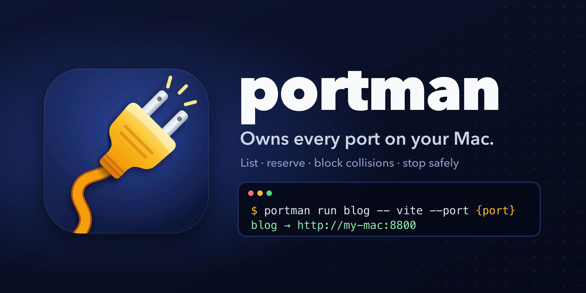

<p align="center">
  
</p>

<p align="center">
  <a href="LICENSE"></a>
  
  
  
</p>

**portman** owns every TCP port on your Mac. It shows who listens where, hands out ports by name, starts servers
on the port they own, and stops them without taking down the terminal or agent that started them. As a
[Claude Code](https://docs.claude.com/en/docs/claude-code) hook, it blocks a server start on a taken port before
the server ever runs.

## Why

On macOS, a server can bind `100.101.102.103:8790` while another one already listens on `*:8790`. Both start
without an error. From then on the specific bind wins every connection to that address, and the wildcard server
silently stops getting that traffic.

That is how portman started: a coding agent launched a preview on the Mac's Tailscale address and quietly took
every other device's traffic away from a long-running service on the same port. Nothing owned port choice, so
nothing noticed. portman is that owner.

## What it does

- **One table for every listener.** `portman ls` merges `lsof`, `netstat`, `ps` and `launchctl`, groups sockets
  by process group, and shows each server's port, reach (loopback, LAN, tailnet, all), kind, PID, uptime and URL.
  Conflicts come first, with which server answers which address.
- **Ports by name.** `portman claim blog` reserves a free port from a pool (8800–8899) and returns the same one
  every time. A reservation belongs to a project folder or a launchd job.
- **Servers start on the right port.** `portman run blog -- vite --port {port}` fills in the port and address,
  refuses a hard-coded port that disagrees with the reservation, and prints the URL your other devices use.
- **Stopping without collateral damage.** `portman stop blog` stops the whole process group when that is safe,
  and only the server's subtree when the group also holds a terminal, an agent or portman's own caller. It
  re-checks each PID's start time before every signal, so a reused PID is never hit.
- **Collisions blocked before they happen.** The Claude Code `PreToolUse` hook reads each shell command, finds
  servers started on explicit ports (through `nohup`, `env`, `npx`, `cd`, `sh -c` and package scripts), and blocks
  the call with the holder's name and the portman command to use instead. Ordinary commands pass in about 25 ms.
- **A status page for your tailnet.** A read-only page for this Mac and your Tailscale devices, refreshed every
  5 seconds.

`portman ls` on a Mac with two port conflicts:

```text
CONFLICTS
  4567  dashboard-backend (pid 88034) answers [::1] and dashboard-backend (pid 97215) answers 127.0.0.1; "localhost:4567" may reach either
  8790  conf-talk (pid 70631) answers 100.101.102.103; home-hub (pid 2957) answers every other address; conf-talk (pid 70631) holds port 8790, which is reserved for "home-hub"

PORT   BIND      KIND       NAME                     PID    UP    URL / COMMAND
22     all       system     launchd                  1      100d  /sbin/launchd
3000   all       container  OrbStack                 69146  37d   http://my-macbook-pro:3000
!4567  loopback  dev        dashboard-backend        88034  3d    /opt/homebrew/Cellar/node/26.8.1/bin/node --require /Users/me/Documen…
!4567  loopback  dev        dashboard-backend        97215  5d    /opt/homebrew/Cellar/node/26.8.1/bin/node --require /Users/me/Documen…
5000   all       system     com.apple.controlcenter  38559  34d   /System/Library/CoreServices/ControlCenter.app/Contents/MacOS/Control…
!8790  all       service    home-hub                 2957   2d    http://my-macbook-pro:8790
!8790  tailnet   dev        conf-talk +64508,9229    70631  2h    http://my-macbook-pro:8790
15721  all       app        CC Switch                66020  34d   http://my-macbook-pro:15721

2 more listen only on this Mac: portman ls --all

RESERVED, NOT RUNNING
  8123  mlx-whisper  service
```

## Requirements

- macOS. portman reads `lsof`, `netstat`, `ps` and `launchctl`.
- Node.js 24.4 or newer (developed on Node 26) at `/opt/homebrew/bin/node`, where Homebrew puts it on Apple
  Silicon. `bin/portman` and `bin/install.sh` call that path directly; edit both if your Node lives elsewhere.
- Optional: [Tailscale](https://tailscale.com) for tailnet URLs and the status page, `jq` for a faster hook,
  [Claude Code](https://docs.claude.com/en/docs/claude-code) for the hook itself.

## Install

```sh
git clone https://github.com/andrew54068/portman.git
cd portman
./bin/install.sh
```

`install.sh` copies the checkout to `~/.local/share/portman` (macOS won't let a launchd job read `~/Documents`),
links `~/.local/bin/portman` to the copy, and installs the LaunchAgent `com.dawson.portman` that keeps the status
page running. Put `~/.local/bin` on your `PATH`, and re-run `install.sh` after every `git pull`: until then the
CLI, the hook and the status page keep running the old copy.

### Claude Code hook

Add this to `~/.claude/settings.json`:

```json
{
  "hooks": {
    "PreToolUse": [
      {
        "matcher": "Bash",
        "hooks": [{ "type": "command", "command": "$HOME/.local/bin/portman hook", "timeout": 5 }]
      }
    ]
  }
}
```

Exit code 2 blocks the command, in bypass-permissions mode too. If portman itself fails, the command runs.

## Usage

```text
portman ls [--all] [--json]       servers reachable from other machines (--all: everything); --json lists all
portman claim <name> [--port N]   reserve a port under a name and print it (idempotent; picks one if no --port)
      [--project DIR] [--kind service|preview] [--launchd LABEL] [--note TEXT] [--force]
portman run <name> [--bind tailnet|loopback|all] [--detach] -- <command using {port} and {ip}>
                                  claim the name's port, start the server on it, print its URL
portman release <name>            drop a reservation
portman stop <name|port|id>       stop a server (launchd jobs need --unload) [--id=<id>] [--json]
portman url <name>                address other tailnet devices use for a reservation
portman serve [--port N]          read-only status page for this Mac and the tailnet (reserved as "portman")
portman hook                      Claude Code PreToolUse hook: blocks server starts on taken ports (exit 2)
```

```sh
portman claim blog                                   # → 8800, and 8800 again next time
vite --port "$(portman claim blog)"                  # stdout carries only the port
portman run blog -- vite --port {port}               # claim, start, print http://<this-mac>:8800
portman run docs --detach -- python3 -m http.server {port} --bind {ip}
portman stop blog
portman release blog
```

`run` binds the Tailscale address by default (`--bind loopback` or `--bind all` to change that) and exports
`PORT` and `HOST` for servers that read them. `--detach` gives the server its own session and a log in
`~/Library/Logs/portman/<name>.log`, so it outlives the shell that started it.

## Status page

The LaunchAgent runs `portman serve` on the port reserved as `portman`; `portman url portman` prints the address.
The page lists every listener, flags conflicts and shows reservations that aren't running.

It binds `127.0.0.1` and the Mac's Tailscale address explicitly, never `*`, so no other server can shadow it. It
answers only loopback and tailnet clients, rejects foreign `Host` headers (DNS rebinding), accepts only `GET` and
`HEAD`, and inserts everything from the scan as text, never HTML. Log: `~/Library/Logs/portman/serve.log`.

## Configuration

Reservations live in `~/.config/portman/registry.json` (set `PORTMAN_HOME` to use another folder). Besides
`reservations`, it has `pool`, the range `claim` picks from (default `[8800, 8899]`), and an optional `host`, the
name other devices use for this Mac. `host` defaults to the local hostname; set it to your MagicDNS name if that
doesn't resolve on your tailnet.

## How it works

- **Scan.** `lsof` and `netstat` (which also sees root and launchd listeners `lsof` can't), plus `ps` and
  `launchctl`, grouped into one app per process group. Each command takes about 10 ms; they run in parallel.
- **Registry.** Named reservations owned by a project folder or a launchd job, edited under a lock file and
  written atomically.
- **Stop.** Never terminals, multiplexers, agents or portman's caller; launchd jobs only with `--unload`, which
  only a person may use, never an agent.
- **Hook.** A deliberately narrow shell parser: only known server tools count, so `curl …:8790`, `ssh -p 22` or a
  commit message that mentions a port never block anything.

## Uninstall

```sh
launchctl bootout "gui/$(id -u)/com.dawson.portman"
rm ~/Library/LaunchAgents/com.dawson.portman.plist ~/.local/bin/portman
rm -r ~/.local/share/portman ~/.config/portman ~/Library/Logs/portman ~/Library/Caches/portman
```

Then remove the hook from `~/.claude/settings.json`.

## Development

```sh
yarn install     # TypeScript and @types/node, for type checking only
node --test      # runs against captured lsof/netstat/ps output; never signals real processes
yarn typecheck
```

There is no build step: Node runs the `.ts` sources directly, and portman has no runtime dependencies. See
[CONTRIBUTING.md](CONTRIBUTING.md) before opening a pull request.

## Security

Please report vulnerabilities privately; see [SECURITY.md](SECURITY.md).

## License

[MIT](LICENSE). The icon and banner in `assets/` are original artwork under the same license.
